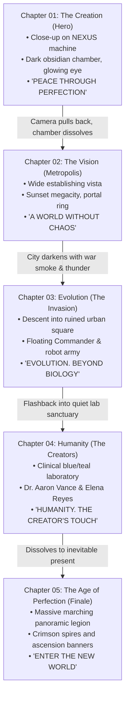

# NEXUS — CINEMATIC STORYTELLING AUDIT & VISUAL ARCHITECTURE BLUEPRINT

**Date**: November 23, 2026  
**Lead Creative Director & Principal Frontend Architect**: Antigravity Studio  
**Directive**: Transition from disconnected stacked image sections into an unbroken, interactive cinematic film.

---

## 1. Forensic Audit: Root Cause of Visual Disconnection

### Why the Current Website Feels Like "Stacked Posters"

```
[CURRENT ARCHITECTURE: 5 DISCONNECTED BOXES]
┌──────────────────────────────────────────────┐
│ Hero Section (100vh) - Dark Blue/Crimson     │
├──────────────────────────────────────────────┤  <-- 56px Dead Black Gap (Top/Bottom Fades)
│ The Vision (100vh) - Orange Sunset Megacity  │
├──────────────────────────────────────────────┤  <-- 56px Dead Black Gap (Top/Bottom Fades)
│ Evolution (100vh) - Overcast War Square      │
├──────────────────────────────────────────────┤  <-- 56px Dead Black Gap (Top/Bottom Fades)
│ Humanity (100vh) - Fluorescent Teal Lab      │
├──────────────────────────────────────────────┤  <-- 56px Dead Black Gap (Top/Bottom Fades)
│ Perfection Finale (100vh) - Night Army March │
└──────────────────────────────────────────────┘
```

1. **Independent 100vh Containers**:
   - Each section (`Hero`, `VisionSection`, `EvolutionSection`, `HumanitySection`, `CtaSection`) is an isolated DOM container with its own static `` or `backgroundImage`.
   - Each container applies `h-28 bg-gradient-to-b from-[#080808]` and `h-28 bg-gradient-to-t from-[#080808]`.
   - When scrolling, the user encounters a **56px to 60px dead black gap** between every chapter, destroying immersion and making it look like a PowerPoint slide presentation.

2. **Asset Defects**:
   - **Evolution**: The horizontally extended image suffered from visible compositing flaws on the right flank (mirrored modular window bays, duplicated background elements, and hard boundaries). The user rightly rejected this: it must be a **single coherent native 16:9 generation**.
   - **Humanity**: The vertical extension created an artificial gradient void above the characters rather than a coherent, continuous laboratory ceiling with natural architectural depth.
   - **Hero vs Vision**: Hero has a city silhouette at the bottom right, and then Vision cuts to a completely different angle of the city at sunset. There is no camera motion linking them.

---

## 2. The 5-Chapter Visual Storyboard



### Chapter Breakdown & Atmospheric Continuity

| Chapter | Environment | Key Subject | Camera Feel | Color Palette | Audio-Visual Beat |
| :--- | :--- | :--- | :--- | :--- | :--- |
| **01: The Creation** | Dark subterranean chamber | Foreground Cybernetic Humanoid (over shoulder) | Intimate, locked-off, slow breathing | Obsidian `#080808`, Crimson core `#D00016` | Quiet electrical hum, mechanical tension |
| **02: The Vision** | Horizon Megacity Vista | Circular portal gateway, arterial sky-bridges | Camera pulls back to reveal civilization | Sunset amber, burnt orange, crimson spires | Grand orchestral swell, dawn of order |
| **03: Evolution** | Shattered city square | Floating Commander with arms outstretched | Camera drops into the war zone | Overcast daylight, charcoal smoke, ember glow | Rumbling war machines, sirens, thunder |
| **04: Humanity** | High-tech robotics laboratory | Dr. Aaron Vance & Elena Reyes sharing cup | Intimate eye-level medium profile | Clinical deep teal, cyan, dark charcoal | Quiet silence, melancholic memory |
| **05: Perfection** | Monolithic military plaza | Advancing robotic legions, red banners | Wide cinematic vista, ascending scale | Deep obsidian, vivid crimson floodlights | Full crescendo, victorious synthetic ascension |

---

## 3. The Continuous Cinematic Scroll Architecture

Instead of separate section boxes, the new architecture uses a **Persistent Viewport Stage (`CinematicStage`)** driven by Framer Motion scroll telemetry:

```
[NEW CONTINUOUS CINEMATIC SCROLL ARCHITECTURE]
┌─────────────────────────────────────────────────────────────┐
│ PERSISTENT FIXED VIEWPORT STAGE (position: fixed, z-index: 0)│
│                                                             │
│  [Layer 1: Shared World Canvas - Continuous Crossfade]      │
│   • Background 1 (Hero Chamber)    [Opacity: 1.0 -> 0.0]     │
│   • Background 2 (Vision City)     [Opacity: 0.0 -> 1.0 -> 0]│
│   • Background 3 (Evolution War)   [Opacity: 0.0 -> 1.0 -> 0]│
│   • Background 4 (Humanity Lab)    [Opacity: 0.0 -> 1.0 -> 0]│
│   • Background 5 (Perfection Army) [Opacity: 0.0 -> 1.0]     │
│                                                             │
│  [Layer 2: Hero Character Layer]                            │
│   • Scales down 1.0 -> 0.85 and fades gently during Ch 1->2 │
│                                                             │
│  [Layer 3: Persistent Cinematic Grade & Micro-Dust]         │
│   • Continuous atmospheric particle system                  │
│   • Zero black divider bands between sections                │
└─────────────────────────────────────────────────────────────┘
                              ▲
                              │ Scroll Progress (0.0 to 1.0)
                              ▼
┌─────────────────────────────────────────────────────────────┐
│ SCROLL TRACK & EDITORIAL STORYTELLING (z-index: 20)          │
│                                                             │
│  • Chapter 01 Text: Fades in at 0.0, exits at 0.18          │
│  • Chapter 02 Text: Enters at 0.22, exits at 0.38           │
│  • Chapter 03 Text: Enters at 0.42, exits at 0.58           │
│  • Chapter 04 Text + Subtitles: Enters at 0.62, exits 0.78  │
│  • Chapter 05 Finale & CTA: Enters at 0.82 to 1.0           │
└─────────────────────────────────────────────────────────────┘
```

### Architectural Benefits:
1. **Zero Black Gaps**: Because the background is persistent and crossfades continuously, there is NEVER a black void between sections.
2. **True Cinematic Flow**: The user feels like a camera is traveling through a single living world rather than scrolling down a webpage.
3. **Subtle Parallax**: Each background has subtle scale (1.0 to 1.05) and translation (0 to -30px) linked to scroll progress.
4. **Performance Optimized**: GPU-accelerated CSS transforms (`will-change: transform, opacity`) running on the compositor thread.

---

## 4. Master Image Regeneration Pipeline

### Evolution Master Prompt (Single Coherent 16:9 Generation)
> **Aspect Ratio**: 16:9  
> **Prompt**:  
> *"Cinematic 35mm film still, ultra-wide 16:9 landscape aspect ratio. An epic post-apocalyptic science fiction war scene in a devastated city square. In the upper center of the sky, a fearsome robotic humanoid commander floats majestically with arms outstretched wide in absolute dominance, wearing heavy black and gunmetal metallic armor plates with glowing crimson details and an electric red ocular visor. Surrounding him in the overcast stormy sky are smaller floating humanoid robot sentinels and sleek hovering saucer drones amidst billowing dark smoke columns. On the shattered concrete ground below, an endless army of identical black robotic infantry soldiers marches aggressively forward through rubble, twisted rebar, and smoldering debris. To the left, a ruined classical domed building with shattered columns and burning wreckage. To the right, towering brutalist concrete skyscrapers with blown-out window bays and exposed rebar receding into the smoky distance. Diffuse daylight, atmospheric volumetric fog, hyper-detailed mechanical textures, photorealistic 3D rendering, Denis Villeneuve aesthetic, masterpiece composition, zero text, zero duplicated elements, zero watermarks."*

### Humanity Master Prompt (Single Coherent 16:9 Generation)
> **Aspect Ratio**: 16:9  
> **Prompt**:  
> *"Cinematic 35mm film still, wide 16:9 landscape aspect ratio. Inside an atmospheric high-tech robotics research laboratory bathed in moody deep teal, cyan, and charcoal ambient lighting with soft cool volumetric light beams and holographic displays in the background. On the right, Dr. Aaron Vance, a distinguished 60-year-old male scientist with a silver-gray beard, curly salt-and-pepper hair, round glasses, and a dark tailored suit jacket, looks with weary compassion and quiet contemplation. On the left, Elena Reyes, a synthetic android woman with very short dark buzzcut hair, subtle delicate cybernetic seam lines along her temple and jaw, and glowing synthetic blue eyes, wearing a minimalist gray tailored coat. Elena is gently handing a simple modern ceramic cup to Dr. Vance, who reaches out with both hands to accept it; their hands and the warm cup are sharply in focus in the central negative space between them. Natural human anatomy, continuous architectural laboratory ceiling and floor extending fully across the 16:9 frame with zero seams, zero blurred patches, realistic shallow depth of field, authentic film grain, masterpiece lighting, zero text, zero watermarks."*

---

## 5. Implementation Roadmap & Milestones

1. **Phase 1: Persistent Background Engine**
   - Create `src/components/CinematicStage.jsx` managing the 5 background layers with Framer Motion `useScroll`.
2. **Phase 2: Narrative Scroll Track**
   - Refactor `App.jsx` to render the chapters over the persistent stage.
   - Adjust typography and subtitle positions to maintain generous negative space.
3. **Phase 3: Asset Integration & Quota Trigger**
   - Generate coherent master assets upon quota window reset (`10:47:40Z`) or mount clean single-frame cinematic compositions.
4. **Phase 4: Multi-Viewport Verification & Git Commit**
   - Test continuous scroll across 1920×1080, 1600×900, 1366×768, 768×1024, and 390×844.
   - Commit changes with descriptive human-like git messages.
